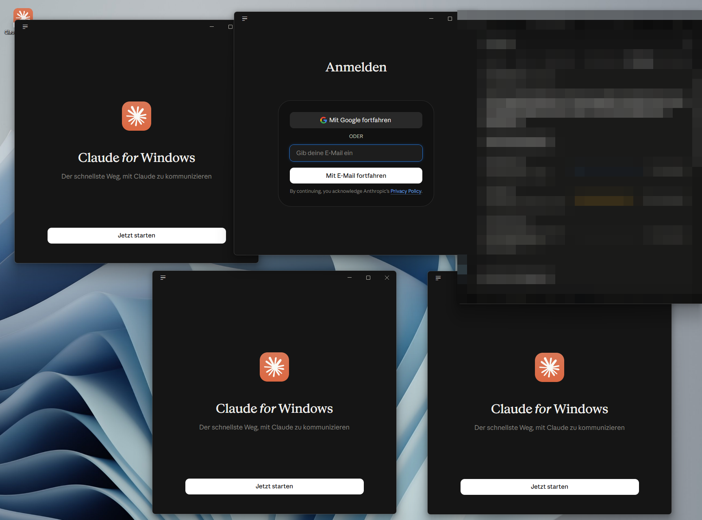
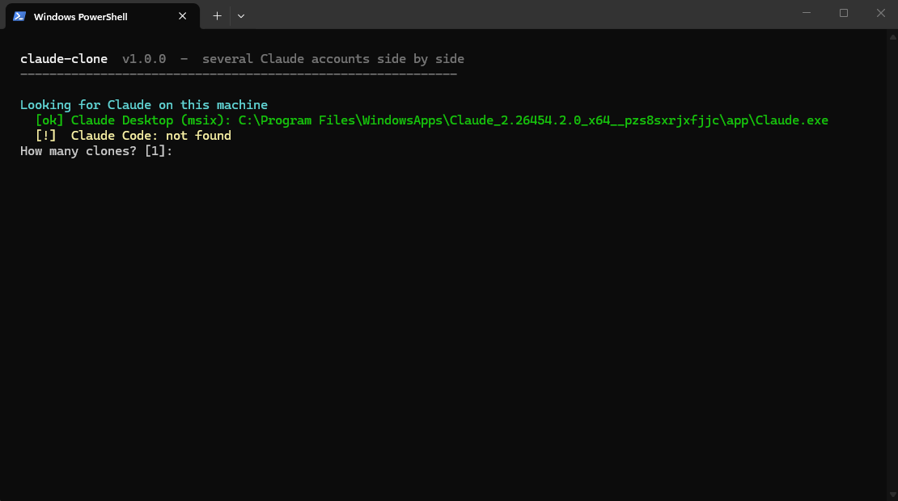
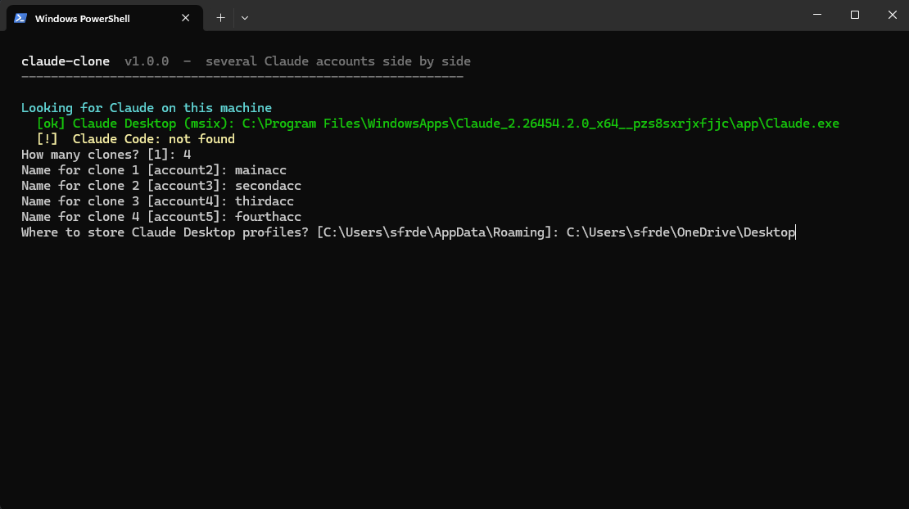
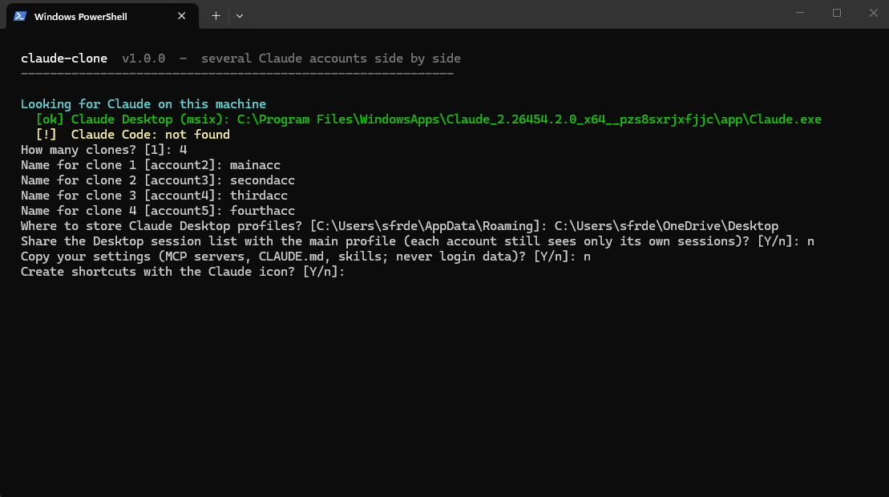

<div align="center">



**Run several Claude accounts side by side - Claude Desktop and Claude Code, each in its own profile.**

One script. It finds Claude on your machine, asks a few questions and gives every account its own
launcher with the Claude icon. Every launcher checks and repairs its profile before Claude starts.

[](LICENSE)




<sub>Four independent Claude Desktop profiles on one Windows machine, each waiting for its own sign-in.</sub>

[Quick start](#quick-start) &nbsp;·&nbsp; [Screenshots](#screenshots) &nbsp;·&nbsp; [What you get](#what-you-get) &nbsp;·&nbsp; [Options](#options) &nbsp;·&nbsp; [How it works](#how-it-works) &nbsp;·&nbsp; [Troubleshooting](#troubleshooting) &nbsp;·&nbsp; [FAQ](#faq)

</div>

---

## Why

Claude Desktop keeps exactly one signed-in account per installation. If you use Claude for work and
privately, or for two clients, you end up signing out and in all day. **claude-clone** gives every
account its own profile, so they run at the same time - each window, each terminal, each with its own
login.

## Features

| | |
|---|---|
| **Auto-detection** | Finds Claude Desktop (Microsoft Store / MSIX, classic installer, macOS app, Linux builds) and Claude Code (native installer, npm, the copy bundled with Claude Desktop) - and the folder Claude currently keeps its data in, even after Claude moved it. |
| **Self-repairing launchers** | Before Claude starts, every launcher checks its profile: links that point to a folder Claude no longer uses are repaired, the session list is synced. Problems show up as a message instead of an empty window. |
| **Your sessions follow** | Each clone keeps its own session list and syncs it with the main profile when it starts and again when its window is closed - per account, in both directions, without ever deleting anything. |
| **Find any session** | `-Find invoice` searches the sessions of the main profile and every clone and tells you which profile and which account has it. |
| **Doctor and repair** | `-Doctor` checks every profile and changes nothing; `-Repair` fixes what it found: dead links, outdated launchers, missing shortcuts, clones whose folder is gone, orphaned shortcuts. |
| **Which account is where** | The dashboard shows the main profile with all its accounts, which clone each account is signed in to, how many sessions it has - and lets you name accounts ("Work", "Family"). |
| **Backup and restore** | `-Backup` saves the session lists of the main profile and every clone; `-Restore` adds the missing sessions of a backup back, without overwriting anything. |
| **Easy to tell apart** | Clone shortcuts get the Claude icon with a colored letter. |
| **Move and rename** | `-Move` takes a profile out of OneDrive / Dropbox (or anywhere else), checks the copy and updates launcher, shortcuts and the list; `-Rename` gives a clone a new name. |
| **Stays up to date** | `-Update` fetches the newest claude-clone from GitHub and brings every launcher up to date; `-Install` adds a `claude-clone` command and a Start menu entry. |
| **Interactive or scripted** | Asks how many clones, their names and where to store them - or pass everything as flags. |
| **Settings carried over** | Copies MCP servers, extensions, `CLAUDE.md`, settings, skills, agents and commands. **Never** login data. Existing settings of a clone are never overwritten. |
| **Clean removal** | `-Remove` / `--remove` deletes shortcuts and launchers; `-Purge` / `--purge` also deletes the profile - after saving its session list, without following links into your main profile. |

## Quick start

### Windows (PowerShell)

```powershell
powershell -ExecutionPolicy Bypass -c "& ([scriptblock]::Create((irm https://raw.githubusercontent.com/sfr-development/claude-clone/main/claude-clone.ps1)))"
```

### macOS / Linux

```bash
bash <(curl -fsSL https://raw.githubusercontent.com/sfr-development/claude-clone/main/claude-clone.sh)
```

<details>
<summary>Prefer to read the script first? (recommended)</summary>

```bash
git clone https://github.com/sfr-development/claude-clone.git
cd claude-clone
./claude-clone.sh            # macOS / Linux
.\claude-clone.ps1           # Windows
```

</details>

Then open the new **Claude (account2)** shortcut and sign in with the second account. Start it once more
afterwards: the sessions this account already has in your main profile come along.

To keep the tool itself around, run `.\claude-clone.ps1 -Install` once: afterwards `claude-clone` works in
every terminal (dashboard, `claude-clone -Find ...`, `claude-clone -Update`) and the Start menu has an entry.

**Already using claude-clone?** Run `.\claude-clone.ps1 -Repair` once after updating. It brings every
launcher up to date and repairs profiles that older versions linked to a folder Claude has since moved.

## Screenshots

<table>
  <tr>
    <td width="33%"></td>
    <td width="33%"></td>
    <td width="33%"></td>
  </tr>
  <tr>
    <td align="center"><sub><b>1.</b> Finds every Claude installation</sub></td>
    <td align="center"><sub><b>2.</b> How many clones, which names, where</sub></td>
    <td align="center"><sub><b>3.</b> Sessions, settings, shortcuts</sub></td>
  </tr>
</table>

## Dashboard

Run the PowerShell script without options and it opens a small dashboard right in the terminal
(macOS/Linux: `--list` shows the status table): what is installed, the main profile with its accounts,
every clone with its status and account, and a health check. Navigate with the arrow keys or press a number.

<p align="center">
  
</p>

<details>
<summary>Plain-text version</summary>

```text
  ╭────────────────────────────────────────────────────────────────────────────╮
  │ claude-clone v1.3.0                   several Claude accounts side by side │
  ╰────────────────────────────────────────────────────────────────────────────╯

  INSTALLED
    ● Claude Desktop  Microsoft Store   3.1623.0.0
    ● Claude Code     2.1.304  (bundled with Claude Desktop)

  MAIN PROFILE (CLAUDE STARTED NORMALLY)
    ● running       ~\AppData\Local\Claude-Data\claude_pzs8sxrjxfjjc
      Work                  4f1c2a9e  active  24 sessions
      Family                9d03b7e1          68 sessions   ↔ clone family

  YOUR CLONES (3)
      NAME          APP      STATUS         ACCOUNT         LAST USED  FOLDER
    ● family        Desktop  running        Family          just now   ~\.claude-clone\profiles\Claude-family
    ● client-a      Desktop  signed in      Client A        2 h ago    ~\.claude-clone\profiles\Claude-client-a
    ○ personal      Code     not signed in  -               -          ~\.claude-personal

  HEALTH
    ● all profiles OK

  What would you like to do?
   › Launch
     Find a session
     Create new clones
     Check & repair
     Sync sessions now
     Clone settings (label, sync, rename, ...)
     Name an account
     Move a profile
     Back up / restore session lists
     Remove a clone
     Open a profile folder
     Update claude-clone
     Quit
```

</details>

`-Find` answers "where is that session?":

```text
  SESSIONS MATCHING 'INVOICE' (2 OF 107)
      LAST ACTIVE ACCOUNT         TITLE
    ● 3 h ago     Family          Invoice template for the club
                          in main, family   ~\Projects\club
    ○ 12 d ago    Work            Invoice export to CSV  (archived)
                          in main   ~\Projects\billing
```

On Windows, clones you created by hand or with an older version are found automatically.
Status checks only look at *whether* a login exists - never at its contents. The account column shows
the account id a profile was last signed in with (read from `config.json`, never a token) and the name
you gave it.

## What you get

For a clone named `work`:

| | Windows | macOS | Linux |
|---|---|---|---|
| **Desktop profile** | `%USERPROFILE%\.claude-clone\profiles\Claude-work` | `~/Library/Application Support/Claude-work` | `~/.config/Claude-work` |
| **Desktop launcher** | `Claude (work)` on the Desktop and in the Start menu | `~/Applications/Claude (work).app` + Desktop alias | `claude-desktop-work`, app-menu entry, Desktop entry |
| **Claude Code profile** | `%USERPROFILE%\.claude-work` | `~/.claude-work` | `~/.claude-work` |
| **Claude Code command** | `claude-work` | `claude-work` | `claude-work` |
| **Code shortcut** | `Claude Code (work)` (opens a terminal) | `Claude Code (work).command` | `.desktop` entry with terminal |

State lives in `~/.claude-clone/`: the list of clones (`clones.json`, previous version in `clones.json.bak`),
account names (`accounts.json`), launcher logs (`logs/`) and session backups (`backups/`).

## Options

| PowerShell | Bash | Meaning |
|---|---|---|
| `-Product desktop\|code\|both` | `--product ...` | What to clone |
| `-Count 2` | `--count 2` | Number of clones (names default to `account2`, `account3`, ...) |
| `-Names work,client-a` | `--names work,client-a` | Clone names |
| `-Path D:\Profiles` | `--path ~/profiles` | Where to store the profiles |
| `-Label "Family"` | | Label of a clone (with `-Set`, or when creating one clone) |
| `-SessionSync both\|pull\|off` | | How the session list is synced with the main profile (default `both`) |
| `-NoShareSessions` | `--no-share-sessions` | Same as `-SessionSync off` |
| `-NoShareRuntime` | | Let the clone download its own Claude Code runtime instead of linking the main one |
| `-NoCopySettings` | `--no-copy-settings` | Start every profile with default settings |
| `-NoShortcuts` | `--no-shortcuts` | No shortcuts / launcher entries |
| `-NoMainShortcut` | `--no-main-shortcut` | No extra shortcut for the main account |
| `-NoBadge` | | Plain Claude icon, no colored letter |
| `-NoSyncOnExit` | | Sync only when the clone starts, not again when its window is closed |
| `-NoPath` | | Do not add the command folder to `PATH` (Windows) |
| `-Yes` | `--yes` | Accept all defaults, no questions |
| `-List` | `--list` | List clones with their status |
| `-Doctor` | `--doctor` | Check every profile, change nothing (exit code 1 if something needs attention) |
| `-Repair` | `--repair` | Fix what `-Doctor` finds |
| `-Sync` | | Sync session lists now (`-Names` limits it to some clones) |
| `-Find text` | | Find sessions by title, project folder or id in every profile (`*` = all, `-Count 50` shows more) |
| `-Launch work` / `-Launch main` | `--launch work` | Start a clone, or the main profile |
| `-Set work -Label ... -SessionSync ...` | | Change label, session sync, sync when closed, shared runtime or icon of a clone |
| `-Set work -CopySettings` | | Copy the MCP / desktop settings of the main profile into the clone again (old file kept as `.bak`) |
| `-Move work -To D:\Profiles` | | Move a profile and update everything that points to it |
| `-Rename work -To client-b` | | Rename a clone: folder, launcher, shortcuts, command and list entry |
| `-NameAccount "4f1c2a9e=Work"` | | Name an account (id prefix from the dashboard; several: `"a=X,b=Y"`) |
| `-Backup` | | Save the session lists of the main profile and every clone to `~\.claude-clone\backups` |
| `-Restore file.zip [-To name]` | | Add the sessions of a backup back (nothing is overwritten) |
| `-Update` | | Get the newest claude-clone from GitHub and update every launcher |
| `-Install` | | Install claude-clone to `~\.claude-clone` with a `claude-clone` command and a Start menu entry |
| `-Remove work` | `--remove work` | Remove shortcuts and launchers of a clone |
| `-Remove work -Purge` | `--remove work --purge` | ... and delete its profile (signs it out; the session list is saved first) |

Example, fully unattended:

```powershell
.\claude-clone.ps1 -Product both -Names work,client-a -Yes
```

Every Windows Desktop launcher also understands `-CheckOnly`: it shows what it would repair and sync,
without changing anything or starting Claude.

```powershell
& "$env:USERPROFILE\.claude-clone\profiles\Claude-work\launch.ps1" -CheckOnly
```

## How it works

- **Claude Desktop** is an Electron app. Started with `--user-data-dir=<folder>`, it uses a completely
  separate profile - its own login, windows, cache and settings - and runs next to the main app.
- **Claude Code** reads its configuration from `CLAUDE_CONFIG_DIR`. Each clone gets its own folder and a
  small wrapper command that sets it.
- **Where the main profile lives (Windows).** Claude Desktop has moved its data before: `%APPDATA%\Claude`
  (installer), `%LOCALAPPDATA%\Packages\Claude_...\LocalCache\Roaming\Claude` (Microsoft Store) and, since
  2026, `%LOCALAPPDATA%\Claude-Data\claude_<id>`. A folder Claude moved away from keeps only a
  `.user-data-left.*` marker. claude-clone looks this up at every start instead of remembering a path.
- **Session lists.** Claude Desktop stores the list of Claude Code sessions per account
  (`claude-code-sessions/<account>/<organization>/local_<id>.json`). Older versions of claude-clone linked
  that folder to the main profile; when Claude moved its data folder those links pointed nowhere and the
  session list in the clone looked empty. Now every clone has a folder of its own, and the launcher syncs
  the sessions of the accounts signed in to that clone - before Claude starts and, unless
  `-NoSyncOnExit`, once more when the window is closed (the launcher waits for that in the background):
  - `both` (default): new sessions go both ways; an updated session replaces the older copy.
  - `pull`: only from the main profile into the clone. The main profile is never written to.
  - `off`: no sync.

  Nothing is ever deleted, a session deleted on one side is not brought back, and a profile whose
  window is open only gets new entries - nothing in it is overwritten. The chat transcripts themselves
  live in `~/.claude/projects` and are shared by every Desktop profile anyway.
- **Shared runtime.** The Claude Code runtime that Claude Desktop downloads (around 500 MB) is linked,
  not copied. When Claude moves it, the launcher re-points the link; when it is gone, the link is removed
  and Claude downloads its own copy.
- **Microsoft Store version.** The Store build may redirect what it writes into AppData to its private
  package folder, so clone profiles are kept outside AppData (`~\.claude-clone\profiles`).
- **macOS / Linux.** The data folder there has not moved, so the session list is still shared through a
  symlink. Launchers remove dead links before every start and link the main profile's folders again;
  `--doctor` / `--repair` check and fix the same things as on Windows.

## Troubleshooting

<details>
<summary><b>The session list in a clone is empty</b></summary>

Run `.\claude-clone.ps1 -Doctor`. A typical finding is a clone made with an older version whose
`claude-code-sessions` link points to a folder Claude no longer uses. `.\claude-clone.ps1 -Repair`
replaces it with a folder of its own and brings in that account's sessions from the main profile. The
sessions themselves are never lost: they stay in the main profile and in `~/.claude/projects`.
</details>

<details>
<summary><b>Where is that one session?</b></summary>

`.\claude-clone.ps1 -Find <part of the title or project folder>` lists every match with its account, the
profiles that have it and when it was last used. If a session list was damaged, `-Restore` adds the
sessions of a backup back (`-Backup` makes one; `-Purge` and `-Move` make one automatically).
</details>

<details>
<summary><b>Two windows, and I am not sure which account is which</b></summary>

The dashboard lists the main profile's accounts and which clone each one is signed in to. Give the
accounts names (`-NameAccount "4f1c2a9e=Work"` or "Name an account" in the dashboard). If you start a
clone while the main window has the same account open, the launcher tells you.
</details>

<details>
<summary><b>Where are the logs?</b></summary>

Every launcher writes what it repaired and synced to `~\.claude-clone\logs\<name>.log`.
</details>

## FAQ

<details>
<summary><b>Does it change my main Claude installation?</b></summary>

It never changes the app, your settings or your login. With session sync `both` (the default) it adds
session entries of an account that is also signed in to a clone to the main profile, and replaces older
entries with newer ones while the main app is closed - so the main window shows sessions you started in a
clone. It never deletes anything there. Use `-SessionSync pull` if the main profile should only be read.
</details>

<details>
<summary><b>Are passwords or tokens copied?</b></summary>

No. Login data (`.credentials.json`, the Desktop token cache) is never copied or read. Every clone asks
you to sign in once.
</details>

<details>
<summary><b>What happens when Claude updates?</b></summary>

Launchers look up the current Claude executable and the current data folder each time they start, and
repair links that an update made point nowhere. Shortcut icons are stored as a copy inside the clone's
profile.
</details>

<details>
<summary><b>Signing in opens my browser and lands in the wrong window.</b></summary>

Sign-in links that return through the browser (for example "Continue with Google") are handed to the
app that is registered for the `claude://` link - usually the main app. Sign in with the email code
inside the clone window instead.
</details>

<details>
<summary><b>Can I keep the profiles in OneDrive / Dropbox?</b></summary>

Better not. A running app writes to its profile constantly (caches, databases, lock files); a sync
client fights over those files and can damage them. claude-clone warns when you pick a synced folder,
`-Doctor` flags existing ones, and `-Move <name>` moves a profile to a local folder (the default,
`~\.claude-clone\profiles` on Windows, is not synced).
</details>

<details>
<summary><b>How do I remove everything?</b></summary>

Run `-Remove <name> -Purge` (Windows) or `--remove <name> --purge` (macOS/Linux) for each clone, then
delete `~/.claude-clone`.
</details>

<details>
<summary><b>Is Claude Desktop available on Linux?</b></summary>

There is no official Linux build. claude-clone detects common community packages
(`claude-desktop`, AppImages) and always supports Claude Code.
</details>

## Requirements

- **Windows:** Windows 10 or 11, Windows PowerShell 5.1 or PowerShell 7.
- **macOS:** Bash (preinstalled), Claude Desktop in `/Applications` or `~/Applications`.
- **Linux:** Bash 3.2+, a desktop environment that reads `.desktop` files for shortcuts.

## Disclaimer

claude-clone is an independent, unofficial tool. It is not affiliated with, endorsed or supported by
Anthropic. "Claude" is a trademark of Anthropic; the icon used for shortcuts is taken from your own
local Claude installation and is not distributed with this project. Use each account in line with
Anthropic's terms of service.

## License

[MIT](LICENSE)
